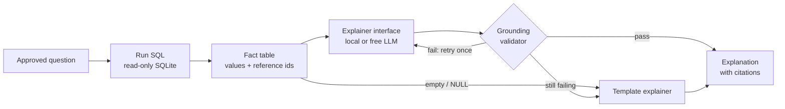

# SQL Result Explainer

Explains the results of approved analytics SQL queries in plain language, without inventing numbers.
Every figure in an explanation is checked against the rows the query returned, and every claim
cites the metric it came from.

> **Status:** in development. Setup steps, the data model, the question list and tests are added
> to this README as they land.

## The problem

Ask a language model to summarise a table and it will often round, extrapolate or invent figures
that sound right but were never in the data. For analytics that is worse than no summary at all.

This project keeps the model on a short leash:

- **SQL does all the math.** Growth rates, shares and averages are computed in the query. The
  model only describes values it is given.
- **Only approved questions run.** A curated set of 8–10 SQL questions over a synthetic dataset.
  The model never writes SQL.
- **Every number is verified.** A grounding validator rejects any explanation that contains a
  figure missing from the result, or cites a metric that doesn't hold that figure.
- **Safe fallback.** If the model can't produce a grounded explanation, a deterministic template
  explanation is shown instead, clearly marked.

## Architecture (planned)

| Component | Role |
|-----------|------|
| Dataset | Synthetic online-store data (customers, products, orders, returns), generated from a fixed seed |
| Approved questions | One `.sql` file per question. The only SQL the app will run |
| Fact table | Query rows turned into referenced values, e.g. `[r3.revenue]` |
| Explainer interface | One boundary for AI calls. Works with any OpenAI-compatible endpoint (Ollama, LM Studio, Groq, OpenRouter) or a no-model template |
| Grounding validator | Checks every number and citation against the fact table |

## Tech

Python 3.11+ · SQLite · pytest. Runs without an API key using the template explainer. Model
settings come from environment variables, never from code.
