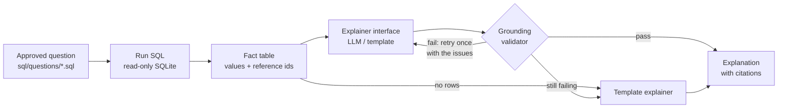
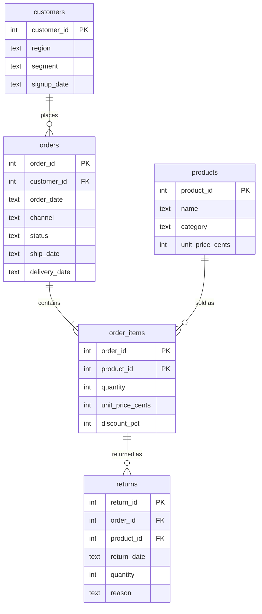

# SQL Result Explainer

[](https://github.com/AadityaU/result-explainer/actions/workflows/tests.yml)

Explains the results of approved analytics SQL queries in plain language, without inventing numbers.
Every figure in an explanation is checked against the rows the query returned, and every claim
cites the metric it came from.

```text
$ python -m result_explainer ask q03
q03 | Revenue and average order value by region
How do net revenue and average order value differ across customer regions?

region   delivered_orders  net_revenue  avg_order_value
-------  ----------------  -----------  ---------------
North               1,008  $327,496.25          $324.90
East                  976  $297,743.54          $305.07
South                 883  $276,968.74          $313.67
West                  820  $258,513.97          $315.26
Central               349  $100,843.14          $288.95

Explanation (template - deterministic summary, no model used)
The query returned 5 rows [meta.row_count]. Net revenue peaked at $327,496.25 for North
[r1.net_revenue]. That row also shows delivered orders 1,008 [r1.delivered_orders],
average order value $324.90 [r1.avg_order_value]. The lowest net revenue was $100,843.14
for Central [r5.net_revenue].

Cited facts
  [meta.row_count]                    5  rows returned
  [r1.net_revenue]          $327,496.25  North
  ...
```

## The problem

Ask a language model to summarise a table and it will often round, extrapolate or invent figures
that sound right but were never in the data. For analytics that is worse than no summary at all.

This project keeps the model on a short leash:

- **SQL does all the math.** Growth rates, shares and averages are computed in the query. The
  model only describes values it is given.
- **Only approved questions run.** Ten curated SQL questions over a synthetic dataset. The model
  never writes SQL, and the database is opened read-only.
- **Every number is verified.** A grounding validator rejects any explanation that contains a
  figure missing from the result, or cites a metric that doesn't hold that figure.
- **Safe fallback.** If the model can't produce a grounded explanation in two attempts, a
  deterministic template explanation is shown instead, clearly marked.

## Quick start

Requires Python 3.10+. **No API key is needed**: without model settings the deterministic
template explainer is used, and every test runs offline.

```bash
git clone https://github.com/AadityaU/result-explainer.git
cd result-explainer
python -m venv .venv
.venv\Scripts\activate              # macOS/Linux: source .venv/bin/activate
pip install -e ".[dev]"
python -m result_explainer build-db
python -m result_explainer check
python -m result_explainer ask q03
pytest
```

## Commands

| Command | What it does |
|---------|--------------|
| `build-db` | Builds `build/store.db` from `sql/schema.sql` and `data/*.csv` |
| `list` | Lists the approved questions |
| `ask <id>` | Runs one approved question and explains the result. Options: `--explainer auto\|template\|llm\|faulty`, `--show-sql`, `--show-facts`, `--db PATH` |
| `check` | Runs every approved question, checks its columns, and checks that its template explanation passes the validator |
| `generate-data` | Rewrites `data/*.csv` from the seeded generator (`--seed`, default 42) |

`--explainer auto` (the default) uses the model when `LLM_BASE_URL` is set, otherwise the template.

## Using a language model

Any OpenAI-compatible chat endpoint works. Copy `.env.example` to `.env` and fill it in.
`.env` is gitignored, and nothing in the code holds a key.

| Option | Settings in `.env` |
|--------|--------------------|
| Ollama (local, free, no key) | `LLM_BASE_URL=http://localhost:11434/v1` and `LLM_MODEL=<a model you pulled>` |
| Groq or OpenRouter (free tiers) | the provider's base URL, a model id, and `LLM_API_KEY` |

```bash
python -m result_explainer ask q05 --explainer llm
```

Missing settings are reported as an error. An unreachable endpoint, or an answer that fails
validation twice, falls back to the template summary and the output shows why.

## Architecture



| Component | File | Role |
|-----------|------|------|
| Approved questions | `sql/questions/`, `questions.py` | One `.sql` file per question with metadata in header comments. The only SQL the app runs |
| Database | `db.py` | Builds SQLite from the CSVs and opens it with `mode=ro` for queries |
| Fact table | `facts.py`, `formatting.py` | Turns rows into referenced values such as `[r1.net_revenue] = $327,496.25` |
| Explainer interface | `explainers/base.py` | One `explain(facts, feedback)` method; only `explainers/llm.py` calls a model |
| Grounding validator | `validator.py` | Checks every number and citation against the fact table |
| Pipeline | `pipeline.py` | Runs the question, retries once with feedback, falls back to the template |

## Data model

A fictional online store's 2025 activity, generated by `src/result_explainer/generate.py` from a
fixed seed (42). All data is synthetic. The same seed always produces byte-identical CSVs, and a
test checks that the committed `data/*.csv` match a fresh generation. The DDL is in
[`sql/schema.sql`](sql/schema.sql).



| Table | Rows | Notes |
|-------|-----:|-------|
| `customers` | 2,500 | region (North, South, East, West, Central) and segment (consumer, business) |
| `products` | 40 | 5 categories × 8 products |
| `orders` | 4,310 | channel (web, mobile, marketplace); cancelled orders have no ship or delivery date |
| `order_items` | 7,515 | price at order time; discount 0, 10 or 20%, heavier in November |
| `returns` | 437 | one row per returned order line; Apparel is returned most often |

Money is stored as integer cents. Queries sum in cents and convert to dollars once, at the end.

**Metric definitions**

- **Net revenue**: quantity × unit price × (100 − discount %) / 100, delivered orders only, before returns.
- **Average order value**: net revenue ÷ delivered orders.
- **Return rate**: units returned ÷ units sold on delivered orders.
- **Repeat customer**: a customer with two or more delivered orders.
- **New customer in a quarter**: the customer's first delivered order falls in that quarter.
- **Delivery days**: days from order date to delivery date.

## Approved questions

Each question is a single SQL file in [`sql/questions/`](sql/questions) with a metadata header:

```sql
-- id: q01
-- title: Monthly revenue and order count
-- question: How did net revenue and the number of delivered orders change month by month in 2025?
-- columns: month=label, delivered_orders=count, net_revenue=currency
-- focus: net_revenue
```

`columns` declares each output column's type (`label`, `count`, `currency`, `percent` or
`number`). The type controls how values are displayed and matched. A result whose columns differ
from the header is refused. `focus` is the main metric the template summary describes.

| id | Question | Rows | Edge case it covers |
|----|----------|-----:|---------------------|
| q01 | Monthly revenue and order count | 12 | time series |
| q02 | Top 10 products by net revenue | 10 | ranking, ties broken by product id |
| q03 | Revenue and average order value by region | 5 | ratio computed in SQL |
| q04 | Revenue share by sales channel | 3 | shares computed in SQL, may not sum to exactly 100 |
| q05 | Month-over-month revenue growth | 12 | the first month's growth is NULL, shown as `n/a` |
| q06 | Repeat-customer rate | 1 | single-row result |
| q07 | Return rate by category | 5 | LEFT JOIN with a zero default |
| q08 | New vs returning customers by quarter | 4 | a real zero: no returning customers in the first quarter |
| q09 | Delivery time by region | 5 | decimal averages |
| q10 | Orders that missed the 14-day delivery promise | 0 | **empty result by design** |
