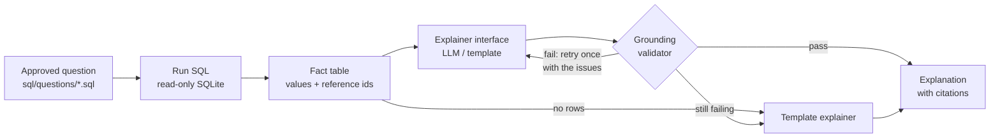
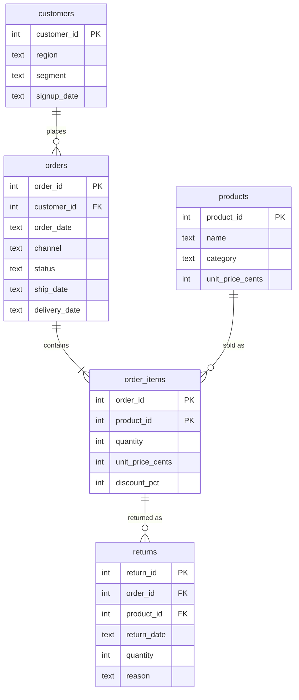

# SQL Result Explainer

[](https://github.com/AadityaU/result-explainer/actions/workflows/tests.yml)

Explains the results of approved analytics SQL queries in plain language, without inventing numbers.
Every figure in an explanation is checked against the rows the query returned, and every claim
cites the metric it came from.

```text
$ python -m result_explainer ask q03
q03 | Revenue and average order value by region
How do net revenue and average order value differ across customer regions?

region   delivered_orders  net_revenue  avg_order_value
-------  ----------------  -----------  ---------------
North               1,008  $327,496.25          $324.90
East                  976  $297,743.54          $305.07
South                 883  $276,968.74          $313.67
West                  820  $258,513.97          $315.26
Central               349  $100,843.14          $288.95

Explanation (template - deterministic summary, no model used)
The query returned 5 rows [meta.row_count]. Net revenue peaked at $327,496.25 for North
[r1.net_revenue]. That row also shows delivered orders 1,008 [r1.delivered_orders],
average order value $324.90 [r1.avg_order_value]. The lowest net revenue was $100,843.14
for Central [r5.net_revenue].

Cited facts
  [meta.row_count]                    5  rows returned
  [r1.net_revenue]          $327,496.25  North
  ...
```

## The problem

Ask a language model to summarise a table and it will often round, extrapolate or invent figures
that sound right but were never in the data. For analytics that is worse than no summary at all.

This project keeps the model on a short leash:

- **SQL does all the math.** Growth rates, shares and averages are computed in the query. The
  model only describes values it is given.
- **Only approved questions run.** Ten curated SQL questions over a synthetic dataset. The model
  never writes SQL, and the database is opened read-only.
- **Every number is verified.** A grounding validator rejects any explanation that contains a
  figure missing from the result, or cites a metric that doesn't hold that figure.
- **Safe fallback.** If the model can't produce a grounded explanation in two attempts, a
  deterministic template explanation is shown instead, clearly marked.

## Quick start

Requires Python 3.10+. **No API key is needed**: without model settings the deterministic
template explainer is used, and every test runs offline.

```bash
git clone https://github.com/AadityaU/result-explainer.git
cd result-explainer
python -m venv .venv
.venv\Scripts\activate              # macOS/Linux: source .venv/bin/activate
pip install -e ".[dev]"
python -m result_explainer build-db
python -m result_explainer check
python -m result_explainer ask q03
pytest
```

## Commands

| Command | What it does |
|---------|--------------|
| `build-db` | Builds `build/store.db` from `sql/schema.sql` and `data/*.csv` |
| `list` | Lists the approved questions |
| `ask <id>` | Runs one approved question and explains the result. Options: `--explainer auto\|template\|llm\|faulty`, `--show-sql`, `--show-facts`, `--db PATH` |
| `check` | Runs every approved question, checks its columns, and checks that its template explanation passes the validator |
| `generate-data` | Rewrites `data/*.csv` from the seeded generator (`--seed`, default 42) |

`--explainer auto` (the default) uses the model when `LLM_BASE_URL` is set, otherwise the template.

## Using a language model

Any OpenAI-compatible chat endpoint works. Copy `.env.example` to `.env` and fill it in.
`.env` is gitignored, and nothing in the code holds a key.

| Option | Settings in `.env` |
|--------|--------------------|
| Ollama (local, free, no key) | `LLM_BASE_URL=http://localhost:11434/v1` and `LLM_MODEL=<a model you pulled>` |
| Groq or OpenRouter (free tiers) | the provider's base URL, a model id, and `LLM_API_KEY` |

```bash
python -m result_explainer ask q05 --explainer llm
```

Missing settings are reported as an error. An unreachable endpoint, or an answer that fails
validation twice, falls back to the template summary and the output shows why.

## Architecture



| Component | File | Role |
|-----------|------|------|
| Approved questions | `sql/questions/`, `questions.py` | One `.sql` file per question with metadata in header comments. The only SQL the app runs |
| Database | `db.py` | Builds SQLite from the CSVs and opens it with `mode=ro` for queries |
| Fact table | `facts.py`, `formatting.py` | Turns rows into referenced values such as `[r1.net_revenue] = $327,496.25` |
| Explainer interface | `explainers/base.py` | One `explain(facts, feedback)` method; only `explainers/llm.py` calls a model |
| Grounding validator | `validator.py` | Checks every number and citation against the fact table |
| Pipeline | `pipeline.py` | Runs the question, retries once with feedback, falls back to the template |

## Data model

A fictional online store's 2025 activity, generated by `src/result_explainer/generate.py` from a
fixed seed (42). All data is synthetic. The same seed always produces byte-identical CSVs, and a
test checks that the committed `data/*.csv` match a fresh generation. The DDL is in
[`sql/schema.sql`](sql/schema.sql).



| Table | Rows | Notes |
|-------|-----:|-------|
| `customers` | 2,500 | region (North, South, East, West, Central) and segment (consumer, business) |
| `products` | 40 | 5 categories × 8 products |
| `orders` | 4,310 | channel (web, mobile, marketplace); cancelled orders have no ship or delivery date |
| `order_items` | 7,515 | price at order time; discount 0, 10 or 20%, heavier in November |
| `returns` | 437 | one row per returned order line; Apparel is returned most often |

Money is stored as integer cents. Queries sum in cents and convert to dollars once, at the end.

**Metric definitions**

- **Net revenue**: quantity × unit price × (100 − discount %) / 100, delivered orders only, before returns.
- **Average order value**: net revenue ÷ delivered orders.
- **Return rate**: units returned ÷ units sold on delivered orders.
- **Repeat customer**: a customer with two or more delivered orders.
- **New customer in a quarter**: the customer's first delivered order falls in that quarter.
- **Delivery days**: days from order date to delivery date.

## Approved questions

Each question is a single SQL file in [`sql/questions/`](sql/questions) with a metadata header:

```sql
-- id: q01
-- title: Monthly revenue and order count
-- question: How did net revenue and the number of delivered orders change month by month in 2025?
-- columns: month=label, delivered_orders=count, net_revenue=currency
-- focus: net_revenue
```

`columns` declares each output column's type (`label`, `count`, `currency`, `percent` or
`number`). The type controls how values are displayed and matched. A result whose columns differ
from the header is refused. `focus` is the main metric the template summary describes.

| id | Question | Rows | Edge case it covers |
|----|----------|-----:|---------------------|
| q01 | Monthly revenue and order count | 12 | time series |
| q02 | Top 10 products by net revenue | 10 | ranking, ties broken by product id |
| q03 | Revenue and average order value by region | 5 | ratio computed in SQL |
| q04 | Revenue share by sales channel | 3 | shares computed in SQL, may not sum to exactly 100 |
| q05 | Month-over-month revenue growth | 12 | the first month's growth is NULL, shown as `n/a` |
| q06 | Repeat-customer rate | 1 | single-row result |
| q07 | Return rate by category | 5 | LEFT JOIN with a zero default |
| q08 | New vs returning customers by quarter | 4 | a real zero: no returning customers in the first quarter |
| q09 | Delivery time by region | 5 | decimal averages |
| q10 | Orders that missed the 14-day delivery promise | 0 | **empty result by design** |

## How grounding works

Every cell of the result becomes a **fact** with a reference id: `r{row}.{column}` (rows start
at 1), plus `meta.row_count`. The explainer sees only these facts and must cite them in square
brackets. Run `ask <id> --show-facts` to see them all.

The validator ([`validator.py`](src/result_explainer/validator.py)) splits the explanation into
sentences and reports:

| Issue | Meaning |
|-------|---------|
| `invented_number` | A number that matches no value in the result |
| `uncited_number` | A real value, but not held by any fact cited in the same sentence |
| `mismatched_label` | The sentence names a row (e.g. a region) that none of its citations belong to |
| `unsupported_calculation` | Words like *doubled*, *twice* or *3x* that imply math the query didn't do |
| `unknown_reference` | A citation id that doesn't exist |
| `no_citations` | A non-empty result explained without citing anything |
| `empty` | No text at all |

Matching rules:

- A number may be rounded or abbreviated, as long as it is a faithful rounding:
  `$327,496.25` can be written `$327,496` or `$327.5k`, but not `$327k`.
- Signs are compared as absolute values, so "fell 7.5%" can cite `-7.5%`.
- Digits inside labels (`2025-03`, `2025-Q1`) aren't read as numbers. Years from labels and
  numbers from the question itself ("top 10", "14-day") need no citation.
- `n/a` (NULL) values can't back any number.

The pipeline ([`pipeline.py`](src/result_explainer/pipeline.py)) gives the model two attempts,
sending the validator's issues back as feedback after the first one. If both fail, or the
endpoint errors, the deterministic template summary is shown instead. Each answer is labelled:

| Status | Meaning |
|--------|---------|
| `grounded` | The model's answer passed every check |
| `template` | The template was requested directly (no model) |
| `fallback` | The model's answer was rejected or the call failed; the template is shown and the rejected attempts are listed |
| `empty` | The query returned no rows, so the model was never called |

**Known limitations.** The validator checks numbers, citations and named rows. It does not check
direction words ("rose" vs "fell") or qualitative claims that contain no number or row name. It
also doesn't recognise month names ("March") as the `2025-03` label. These are covered by the
prompt rules, not enforced.

## Failure and edge-case demonstrations

**A model that invents numbers.** The `faulty` explainer inflates a real figure by 25% and adds
a comparison the query never computed. It is rejected on both attempts and the template summary
is shown instead:

```text
$ python -m result_explainer ask q03 --explainer faulty
...
Explanation (fallback - the model's answer was rejected, showing the template summary instead)
The query returned 5 rows [meta.row_count]. Net revenue peaked at $327,496.25 for North
[r1.net_revenue]. ...

Rejected attempts
  1. North led with $409,370.31 [r1.net_revenue], roughly double the next best result.
     - invented_number: $409,370.31 does not appear anywhere in the result
     - unsupported_calculation: "double" implies a calculation the query did not return
  2. ...
```

**An empty result.** q10 returns no rows because every order met the delivery promise. The
model is never called, so it has no chance to fill the gap:

```text
$ python -m result_explainer ask q10
...
(no rows)

Explanation (empty result - nothing to explain, the model was not called)
The query returned 0 rows [meta.row_count], so nothing matched the question "Orders that
missed the 14-day delivery promise".
```

Also covered: NULL growth for the first month in q05 (shown as `n/a`), a model endpoint that is
unreachable (falls back), and missing model settings (clear error, exit code 2).

## Tests

```bash
pytest          # 124 tests, no network needed
python -m result_explainer check
```

| File | Covers |
|------|--------|
| `test_generate.py` | Same seed gives identical bytes; committed CSVs match the generator; data invariants |
| `test_db.py` | Every CSV row loads, foreign keys hold, NULLs survive, read-only connection rejects writes |
| `test_questions.py` | All 10 questions run and return their declared columns; q10 empty; header parsing errors |
| `test_facts.py` | Display formatting, half-up rounding, reference ids, NULL handling |
| `test_validator.py` | Invented, uncited and misattributed numbers; rounding; labels; calculation words |
| `test_template.py` | The template explanation passes the validator for every question |
| `test_llm.py` | Request payload, auth header, error handling and settings, against a mocked endpoint |
| `test_pipeline.py` | Retry with feedback, fallback after two rejections, empty results skip the model |
| `test_cli.py` | Every command and error path |

CI runs `build-db`, `check` and `pytest` from a clean checkout on Python 3.10 and 3.13.

## Project layout

```text
sql/schema.sql                  data model (DDL)
sql/questions/                  the 10 approved questions
data/                           generated sample data (CSV)
src/result_explainer/
  cli.py                        commands
  generate.py                   seeded synthetic data generator
  db.py                         build the database, read-only connections
  questions.py                  question files, registry and runner
  formatting.py  facts.py       displayed values and reference ids
  validator.py                  grounding checks
  explainers/                   base interface, template, llm, faulty (demo only)
  pipeline.py                   retry and fallback
  render.py                     terminal output
tests/                          pytest suite
docs/design-note.md             design and decision note
```
